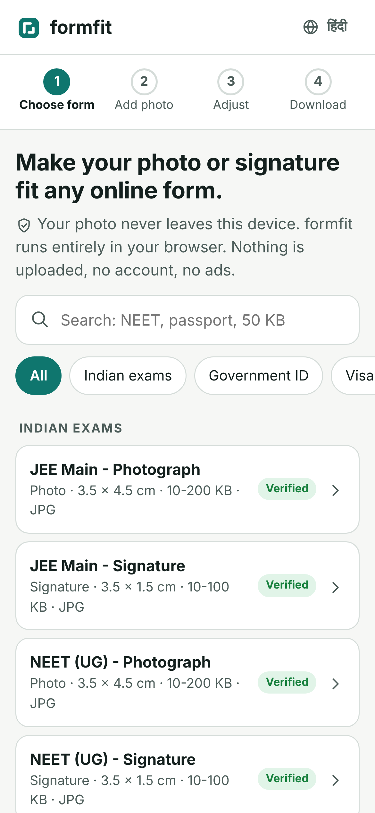
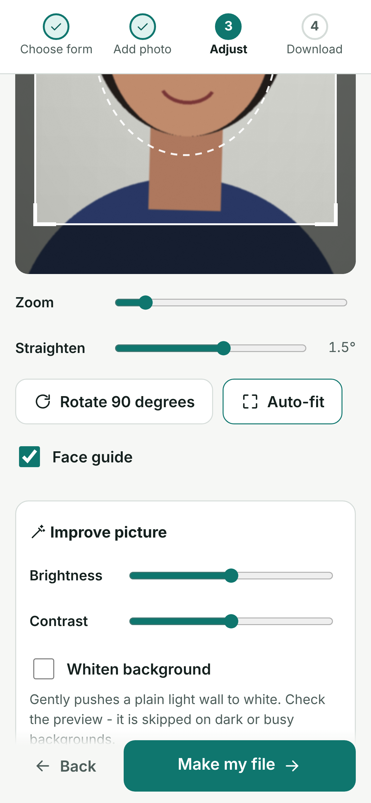
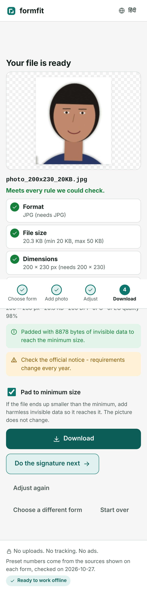

# formfit

**Make your photo or signature fit any online form — exact KB, exact size, right DPI.**
Free, works offline, and your photo never leaves your device.

**Open it:** https://rishitmpatel.github.io/formfit/ (add it to your home screen to use it like an app)

<p>
  
  
  
</p>

Every exam, job and visa portal wants something slightly different: *"Photo: JPG, 10–200 KB, 3.5 × 4.5 cm. Signature: 10–100 KB."* Getting a phone photo into that shape usually means an ad-filled website that uploads your face to a server, plus several tries before the portal accepts it. formfit does it in one go, entirely in your browser.

## How it works

1. **Choose the form.** Pick a preset — JEE Main, NEET UG, GATE, CAT, CUET, UPSC, SSC, IBPS, SBI, RRB, passport, PAN, Aadhaar, US/UK/Canada/Schengen visas — or enter your own rules (pixels or cm/mm/inches, DPI, KB range, JPG/PNG).
2. **Add your photo.** Take one with the camera, pick from the gallery, drag and drop, or paste.
3. **Adjust.** Drag and pinch to crop inside the right frame, with a face guide for photos. Straighten, rotate, brightness/contrast, and optional *whiten background*. For signatures, *clean ink* turns a phone photo of paper into crisp dark ink on pure white and trims the margins.
4. **Download.** formfit finds the best JPEG quality that lands inside the KB range, writes the requested DPI into the file, and shows a green tick against every rule. Exam presets chain straight on to the signature (and thumb impression / declaration where needed).

### Details that make portals accept the file

- **Hits the KB window, not just a maximum.** If the photo comes out *under* the minimum even at top quality, formfit can pad it with harmless invisible data (a standard JPEG comment segment) so it reaches the minimum without changing the picture.
- **Both KB definitions.** It stays below the maximum counting 1 KB = 1000 bytes and above the minimum counting 1 KB = 1024 bytes, so it passes whichever the portal uses.
- **Real DPI.** Writes JFIF density (JPG) / pHYs (PNG) so "200 DPI" checks pass.
- **Exact pixel size** when a form demands it, and an honest message when a size limit can't be met at that resolution.
- **Sources on every preset.** Each preset links the official notice it came from and the date it was checked. Presets that couldn't be verified against an official document say so — requirements change every year, so always glance at the latest notice. See [docs/PRESETS.md](docs/PRESETS.md).

## Private by design

- No uploads, no account, no tracking, no ads. All processing uses your browser's own canvas.
- Works offline after the first visit (it's a Progressive Web App).
- English and हिंदी.

## Run locally

```bash
git clone https://github.com/rishitmpatel/formfit
cd formfit/site
python3 -m http.server 8000      # open http://localhost:8000
```

No build step, no dependencies. The site is plain HTML, CSS and JavaScript modules.

### Tests

```bash
node --test tests/*.test.js     # 48 unit tests: KB search, JPEG/PNG DPI + padding, crop maths, presets
python3 tests/e2e.py            # Playwright: full flows on phone + desktop, light + dark, offline
python3 tests/verify_outputs.py # checks every exported file with Pillow: size, DPI, KB range
```

## Contributing presets

Requirements change each exam season. To add or fix one, edit `site/presets.js` with the official source URL and the date you checked it, then regenerate the table with `node tools/gen-presets-doc.mjs`. Pull requests welcome.

## License

MIT
